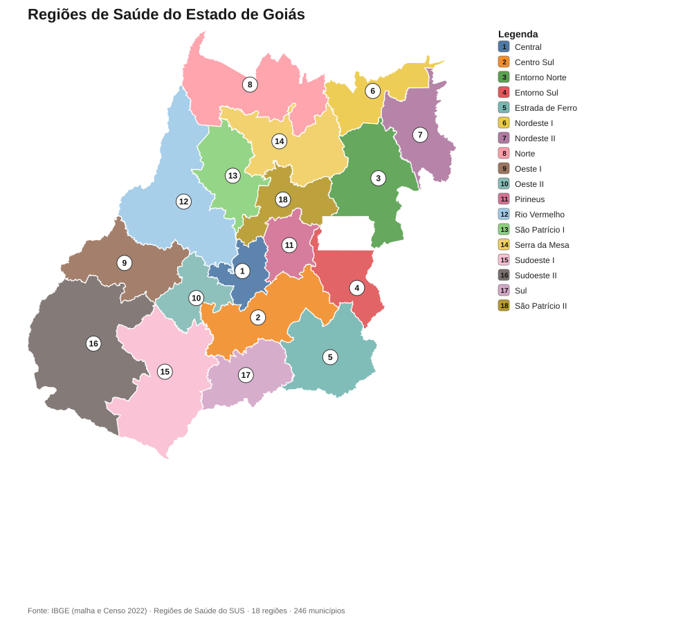
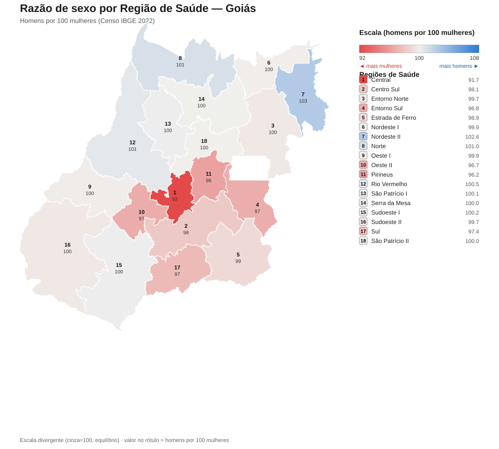

# Regiões de Saúde do Estado de Goiás

O estado de Goiás está dividido em **18 Regiões de Saúde** do SUS, que agrupam os seus **246 municípios**. Abaixo estão os mapas da divisão territorial, a tabela de população por região com recorte de **sexo** (Censo IBGE 2022) e a lista de municípios de cada região.

## Mapa — divisão territorial

## População por Região de Saúde (com recorte por sexo)

A *razão de sexo* indica o número de homens para cada 100 mulheres (acima de 100 = predomínio masculino; abaixo de 100 = predomínio feminino).

| Nº | Região de Saúde | Macrorregião | Mun. | População | Homens | Mulheres | Razão de sexo |
|---:|-----------------|--------------|-----:|----------:|-------:|---------:|--------------:|
| 1 | Central | Centro-Oeste | 26 | 1.888.228 | 903.273 | 984.955 | 91.7 |
| 2 | Centro Sul | Centro Sudeste | 25 | 955.564 | 473.174 | 482.390 | 98.1 |
| 3 | Entorno Norte | Nordeste | 8 | 275.752 | 137.640 | 138.112 | 99.7 |
| 4 | Entorno Sul | Nordeste | 7 | 963.718 | 473.905 | 489.813 | 96.8 |
| 5 | Estrada de Ferro | Centro Sudeste | 18 | 325.940 | 162.058 | 163.882 | 98.9 |
| 6 | Nordeste I | Nordeste | 5 | 41.541 | 20.762 | 20.779 | 99.9 |
| 7 | Nordeste II | Nordeste | 11 | 94.524 | 47.868 | 46.656 | 102.6 |
| 8 | Norte | Centro-Norte | 13 | 131.825 | 66.254 | 65.571 | 101.0 |
| 9 | Oeste I | Centro-Oeste | 16 | 116.132 | 58.028 | 58.104 | 99.9 |
| 10 | Oeste II | Centro-Oeste | 13 | 116.983 | 57.512 | 59.471 | 96.7 |
| 11 | Pirineus | Centro-Norte | 10 | 538.825 | 264.149 | 274.676 | 96.2 |
| 12 | Rio Vermelho | Centro-Oeste | 17 | 202.776 | 101.643 | 101.133 | 100.5 |
| 13 | São Patrício I | Centro-Norte | 20 | 168.047 | 84.086 | 83.961 | 100.1 |
| 14 | Serra da Mesa | Centro-Norte | 9 | 120.645 | 60.333 | 60.312 | 100.0 |
| 15 | Sudoeste I | Sudoeste | 18 | 438.027 | 219.193 | 218.834 | 100.2 |
| 16 | Sudoeste II | Sudoeste | 10 | 236.669 | 118.137 | 118.532 | 99.7 |
| 17 | Sul | Centro Sudeste | 12 | 261.009 | 128.776 | 132.233 | 97.4 |
| 18 | São Patrício II | Centro-Norte | 8 | 180.290 | 90.150 | 90.140 | 100.0 |
| | **Total (Goiás)** | | **246** | **7.056.495** | **3.466.941** | **3.589.554** | **96.6** |

> No conjunto do estado há **122.613** mulheres a mais que homens (razão de sexo de **96.6** homens por 100 mulheres). O predomínio feminino é mais forte nas regiões urbanas — puxado pela **Central (Goiânia)**, com razão de 91,7. Já **7 das 18 regiões** têm leve maioria masculina (Nordeste II, Norte, Rio Vermelho, São Patrício I, Serra da Mesa, Sudoeste I, São Patrício II), padrão típico de áreas de fronteira agrícola do interior.

## Mapa — razão de sexo

Mesmo território, colorido pela **razão de sexo** (escala divergente: cinza = equilíbrio em 100; **vermelho** = predomínio feminino; **azul** = predomínio masculino). O número no rótulo é a razão de sexo da região.

## Municípios por Região de Saúde

### 1. Central  ·  26 municípios  ·  1.888.228 hab.

| Município | População | Homens | Mulheres |
|-----------|----------:|-------:|---------:|
| Goiânia | 1.437.366 | 680.891 | 756.475 |
| Trindade | 142.431 | 69.467 | 72.964 |
| Goianira | 71.916 | 36.001 | 35.915 |
| Inhumas | 52.204 | 25.288 | 26.916 |
| Nerópolis | 31.932 | 15.580 | 16.352 |
| Guapó | 19.545 | 9.679 | 9.866 |
| Abadia de Goiás | 19.128 | 9.716 | 9.412 |
| Anicuns | 18.503 | 9.195 | 9.308 |
| Petrolina de Goiás | 9.573 | 4.789 | 4.784 |
| Nova Veneza | 9.481 | 4.737 | 4.744 |
| Nazário | 8.189 | 4.074 | 4.115 |
| Itauçu | 7.736 | 3.806 | 3.930 |
| Santo Antônio de Goiás | 7.386 | 3.595 | 3.791 |
| São Francisco de Goiás | 6.378 | 3.236 | 3.142 |
| Santa Bárbara de Goiás | 6.149 | 3.027 | 3.122 |
| Caturaí | 5.184 | 2.609 | 2.575 |
| Itaguari | 4.963 | 2.502 | 2.461 |
| Ouro Verde de Goiás | 4.057 | 2.051 | 2.006 |
| Taquaral de Goiás | 4.026 | 1.973 | 2.053 |
| Brazabrantes | 3.992 | 1.984 | 2.008 |
| Araçu | 3.799 | 1.849 | 1.950 |
| Campestre de Goiás | 3.755 | 1.929 | 1.826 |
| Avelinópolis | 2.868 | 1.434 | 1.434 |
| Santa Rosa de Goiás | 2.820 | 1.430 | 1.390 |
| Damolândia | 2.724 | 1.344 | 1.380 |
| Jesúpolis | 2.123 | 1.087 | 1.036 |

### 2. Centro Sul  ·  25 municípios  ·  955.564 hab.

| Município | População | Homens | Mulheres |
|-----------|----------:|-------:|---------:|
| Aparecida de Goiânia | 527.796 | 258.804 | 268.992 |
| Senador Canedo | 155.635 | 77.258 | 78.377 |
| Bela Vista de Goiás | 34.445 | 17.305 | 17.140 |
| Hidrolândia | 27.742 | 14.021 | 13.721 |
| Piracanjuba | 24.883 | 12.511 | 12.372 |
| Silvânia | 22.245 | 11.270 | 10.975 |
| Pontalina | 18.309 | 8.959 | 9.350 |
| Indiara | 17.061 | 8.771 | 8.290 |
| Orizona | 16.399 | 8.292 | 8.107 |
| Vianópolis | 14.956 | 7.422 | 7.534 |
| Aragoiânia | 11.890 | 5.922 | 5.968 |
| Edéia | 11.747 | 5.883 | 5.864 |
| Bonfinópolis | 10.296 | 5.171 | 5.125 |
| Vicentinópolis | 8.768 | 4.497 | 4.271 |
| Leopoldo de Bulhões | 8.745 | 4.436 | 4.309 |
| Cezarina | 8.090 | 4.104 | 3.986 |
| Jandaia | 6.272 | 3.181 | 3.091 |
| Caldazinha | 4.507 | 2.341 | 2.166 |
| São Miguel do Passa Quatro | 4.464 | 2.268 | 2.196 |
| Edealina | 4.001 | 2.007 | 1.994 |
| Cromínia | 3.883 | 1.937 | 1.946 |
| Varjão | 3.716 | 1.870 | 1.846 |
| Professor Jamil | 3.649 | 1.877 | 1.772 |
| Cristianópolis | 3.504 | 1.761 | 1.743 |
| Mairipotaba | 2.561 | 1.306 | 1.255 |

### 3. Entorno Norte  ·  8 municípios  ·  275.752 hab.

| Município | População | Homens | Mulheres |
|-----------|----------:|-------:|---------:|
| Formosa | 115.901 | 57.259 | 58.642 |
| Planaltina | 105.031 | 51.929 | 53.102 |
| São João d'Aliança | 14.041 | 7.460 | 6.581 |
| Flores de Goiás | 13.744 | 7.226 | 6.518 |
| Alto Paraíso de Goiás | 10.306 | 5.126 | 5.180 |
| Cabeceiras | 7.560 | 3.853 | 3.707 |
| Água Fria de Goiás | 4.954 | 2.593 | 2.361 |
| Vila Boa | 4.215 | 2.194 | 2.021 |

### 4. Entorno Sul  ·  7 municípios  ·  963.718 hab.

| Município | População | Homens | Mulheres |
|-----------|----------:|-------:|---------:|
| Águas Lindas de Goiás | 225.693 | 111.618 | 114.075 |
| Luziânia | 209.129 | 103.698 | 105.431 |
| Valparaíso de Goiás | 198.861 | 95.754 | 103.107 |
| Novo Gama | 103.804 | 51.065 | 52.739 |
| Cidade Ocidental | 91.767 | 44.511 | 47.256 |
| Santo Antônio do Descoberto | 72.127 | 35.633 | 36.494 |
| Cristalina | 62.337 | 31.626 | 30.711 |

### 5. Estrada de Ferro  ·  18 municípios  ·  325.940 hab.

| Município | População | Homens | Mulheres |
|-----------|----------:|-------:|---------:|
| Catalão | 114.427 | 57.111 | 57.316 |
| Caldas Novas | 98.622 | 48.269 | 50.353 |
| Pires do Rio | 32.373 | 16.055 | 16.318 |
| Ipameri | 25.548 | 12.724 | 12.824 |
| Corumbaíba | 9.164 | 4.665 | 4.499 |
| Campo Alegre de Goiás | 7.422 | 3.835 | 3.587 |
| Ouvidor | 7.200 | 3.643 | 3.557 |
| Goiandira | 4.973 | 2.457 | 2.516 |
| Rio Quente | 3.864 | 1.935 | 1.929 |
| Urutaí | 3.553 | 1.770 | 1.783 |
| Santa Cruz de Goiás | 3.002 | 1.598 | 1.404 |
| Cumari | 2.927 | 1.484 | 1.443 |
| Três Ranchos | 2.921 | 1.521 | 1.400 |
| Marzagão | 2.758 | 1.403 | 1.355 |
| Palmelo | 2.259 | 1.082 | 1.177 |
| Nova Aurora | 2.101 | 1.075 | 1.026 |
| Davinópolis | 1.902 | 960 | 942 |
| Anhanguera | 924 | 471 | 453 |

### 6. Nordeste I  ·  5 municípios  ·  41.541 hab.

| Município | População | Homens | Mulheres |
|-----------|----------:|-------:|---------:|
| Campos Belos | 18.108 | 8.790 | 9.318 |
| Cavalcante | 9.583 | 4.928 | 4.655 |
| Monte Alegre de Goiás | 6.692 | 3.470 | 3.222 |
| Divinópolis de Goiás | 4.457 | 2.218 | 2.239 |
| Teresina de Goiás | 2.701 | 1.356 | 1.345 |

### 7. Nordeste II  ·  11 municípios  ·  94.524 hab.

| Município | População | Homens | Mulheres |
|-----------|----------:|-------:|---------:|
| Posse | 34.914 | 17.389 | 17.525 |
| Iaciara | 10.584 | 5.354 | 5.230 |
| São Domingos | 9.711 | 5.123 | 4.588 |
| Alvorada do Norte | 8.446 | 4.201 | 4.245 |
| Mambaí | 8.124 | 4.138 | 3.986 |
| Simolândia | 5.742 | 2.886 | 2.856 |
| Guarani de Goiás | 4.085 | 2.119 | 1.966 |
| Damianópolis | 3.770 | 1.902 | 1.868 |
| Buritinópolis | 3.145 | 1.588 | 1.557 |
| Nova Roma | 3.076 | 1.600 | 1.476 |
| Sítio d'Abadia | 2.927 | 1.568 | 1.359 |

### 8. Norte  ·  13 municípios  ·  131.825 hab.

| Município | População | Homens | Mulheres |
|-----------|----------:|-------:|---------:|
| Porangatu | 44.317 | 21.983 | 22.334 |
| Minaçu | 27.075 | 13.562 | 13.513 |
| São Miguel do Araguaia | 21.900 | 11.060 | 10.840 |
| Mundo Novo | 6.189 | 3.186 | 3.003 |
| Formoso | 4.660 | 2.353 | 2.307 |
| Montividiu do Norte | 3.779 | 1.976 | 1.803 |
| Novo Planalto | 3.716 | 1.894 | 1.822 |
| Campinaçu | 3.708 | 1.922 | 1.786 |
| Mutunópolis | 3.564 | 1.818 | 1.746 |
| Bonópolis | 3.299 | 1.683 | 1.616 |
| Santa Tereza de Goiás | 3.293 | 1.661 | 1.632 |
| Estrela do Norte | 3.205 | 1.580 | 1.625 |
| Trombas | 3.120 | 1.576 | 1.544 |

### 9. Oeste I  ·  16 municípios  ·  116.132 hab.

| Município | População | Homens | Mulheres |
|-----------|----------:|-------:|---------:|
| Iporá | 35.684 | 17.419 | 18.265 |
| Aragarças | 18.390 | 9.174 | 9.216 |
| Piranhas | 11.712 | 5.877 | 5.835 |
| Montes Claros de Goiás | 8.756 | 4.471 | 4.285 |
| Bom Jardim de Goiás | 7.826 | 3.966 | 3.860 |
| Fazenda Nova | 5.877 | 2.968 | 2.909 |
| Novo Brasil | 3.527 | 1.794 | 1.733 |
| Baliza | 3.351 | 1.780 | 1.571 |
| Palestina de Goiás | 3.132 | 1.586 | 1.546 |
| Amorinópolis | 3.007 | 1.516 | 1.491 |
| Arenópolis | 2.946 | 1.509 | 1.437 |
| Jaupaci | 2.924 | 1.461 | 1.463 |
| Ivolândia | 2.693 | 1.357 | 1.336 |
| Israelândia | 2.560 | 1.269 | 1.291 |
| Diorama | 2.062 | 1.038 | 1.024 |
| Moiporá | 1.685 | 843 | 842 |

### 10. Oeste II  ·  13 municípios  ·  116.983 hab.

| Município | População | Homens | Mulheres |
|-----------|----------:|-------:|---------:|
| São Luís de Montes Belos | 33.852 | 16.307 | 17.545 |
| Palmeiras de Goiás | 31.858 | 15.817 | 16.041 |
| Paraúna | 10.659 | 5.224 | 5.435 |
| Firminópolis | 10.419 | 5.065 | 5.354 |
| Sanclerlândia | 7.918 | 3.949 | 3.969 |
| Turvânia | 4.480 | 2.244 | 2.236 |
| Palminópolis | 3.851 | 1.904 | 1.947 |
| Aurilândia | 3.284 | 1.653 | 1.631 |
| Buriti de Goiás | 2.732 | 1.372 | 1.360 |
| Córrego do Ouro | 2.454 | 1.237 | 1.217 |
| Adelândia | 2.297 | 1.158 | 1.139 |
| São João da Paraúna | 1.774 | 875 | 899 |
| Cachoeira de Goiás | 1.405 | 707 | 698 |

### 11. Pirineus  ·  10 municípios  ·  538.825 hab.

| Município | População | Homens | Mulheres |
|-----------|----------:|-------:|---------:|
| Anápolis | 398.869 | 193.368 | 205.501 |
| Alexânia | 27.008 | 13.488 | 13.520 |
| Pirenópolis | 26.690 | 13.423 | 13.267 |
| Cocalzinho de Goiás | 25.016 | 12.835 | 12.181 |
| Abadiânia | 17.232 | 8.808 | 8.424 |
| Goianápolis | 13.967 | 7.007 | 6.960 |
| Corumbá de Goiás | 10.562 | 5.407 | 5.155 |
| Campo Limpo de Goiás | 8.081 | 4.084 | 3.997 |
| Terezópolis de Goiás | 7.944 | 3.940 | 4.004 |
| Gameleira de Goiás | 3.456 | 1.789 | 1.667 |

### 12. Rio Vermelho  ·  17 municípios  ·  202.776 hab.

| Município | População | Homens | Mulheres |
|-----------|----------:|-------:|---------:|
| Itaberaí | 44.734 | 22.318 | 22.416 |
| Itapuranga | 26.113 | 12.921 | 13.192 |
| Goiás | 24.071 | 11.920 | 12.151 |
| Jussara | 19.620 | 9.759 | 9.861 |
| Mozarlândia | 14.750 | 7.358 | 7.392 |
| Nova Crixás | 12.815 | 6.606 | 6.209 |
| Aruanã | 8.300 | 4.332 | 3.968 |
| Itapirapuã | 8.007 | 4.005 | 4.002 |
| Araguapaz | 7.153 | 3.563 | 3.590 |
| Faina | 7.070 | 3.667 | 3.403 |
| Britânia | 5.695 | 2.867 | 2.828 |
| Americano do Brasil | 5.259 | 2.577 | 2.682 |
| Santa Fé de Goiás | 4.951 | 2.580 | 2.371 |
| Mossâmedes | 4.654 | 2.334 | 2.320 |
| Matrinchã | 4.042 | 2.035 | 2.007 |
| Heitoraí | 3.354 | 1.711 | 1.643 |
| Guaraíta | 2.188 | 1.090 | 1.098 |

### 13. São Patrício I  ·  20 municípios  ·  168.047 hab.

| Município | População | Homens | Mulheres |
|-----------|----------:|-------:|---------:|
| Ceres | 22.046 | 10.699 | 11.347 |
| Itapaci | 21.087 | 10.582 | 10.505 |
| Rubiataba | 19.788 | 9.796 | 9.992 |
| Crixás | 17.065 | 8.749 | 8.316 |
| Uruana | 13.729 | 6.821 | 6.908 |
| Rialma | 12.165 | 6.011 | 6.154 |
| Santa Terezinha de Goiás | 10.645 | 5.379 | 5.266 |
| Carmo do Rio Verde | 9.710 | 4.906 | 4.804 |
| Nova Glória | 8.310 | 4.188 | 4.122 |
| São Luiz do Norte | 4.837 | 2.465 | 2.372 |
| Campos Verdes | 4.005 | 1.997 | 2.008 |
| Rianápolis | 3.980 | 1.962 | 2.018 |
| Santa Isabel | 3.538 | 1.798 | 1.740 |
| Ipiranga de Goiás | 2.919 | 1.501 | 1.418 |
| Uirapuru | 2.798 | 1.420 | 1.378 |
| Morro Agudo de Goiás | 2.456 | 1.210 | 1.246 |
| Nova América | 2.337 | 1.186 | 1.151 |
| Pilar de Goiás | 2.328 | 1.225 | 1.103 |
| Guarinos | 2.161 | 1.131 | 1.030 |
| São Patrício | 2.143 | 1.060 | 1.083 |

### 14. Serra da Mesa  ·  9 municípios  ·  120.645 hab.

| Município | População | Homens | Mulheres |
|-----------|----------:|-------:|---------:|
| Uruaçu | 42.546 | 20.897 | 21.649 |
| Niquelândia | 34.964 | 17.553 | 17.411 |
| Campinorte | 12.510 | 6.266 | 6.244 |
| Mara Rosa | 10.700 | 5.437 | 5.263 |
| Alto Horizonte | 6.072 | 3.048 | 3.024 |
| Colinas do Sul | 4.030 | 2.083 | 1.947 |
| Hidrolina | 3.545 | 1.796 | 1.749 |
| Amaralina | 3.268 | 1.710 | 1.558 |
| Nova Iguaçu de Goiás | 3.010 | 1.543 | 1.467 |

### 15. Sudoeste I  ·  18 municípios  ·  438.027 hab.

| Município | População | Homens | Mulheres |
|-----------|----------:|-------:|---------:|
| Rio Verde | 225.696 | 113.104 | 112.592 |
| Quirinópolis | 48.447 | 24.037 | 24.410 |
| Santa Helena de Goiás | 38.492 | 18.908 | 19.584 |
| Acreúna | 21.568 | 11.008 | 10.560 |
| São Simão | 17.020 | 8.334 | 8.686 |
| Caçu | 13.774 | 6.856 | 6.918 |
| Montividiu | 12.521 | 6.371 | 6.150 |
| Cachoeira Alta | 11.513 | 5.902 | 5.611 |
| Maurilândia | 10.304 | 5.226 | 5.078 |
| Paranaiguara | 7.607 | 3.630 | 3.977 |
| Itarumã | 6.101 | 3.137 | 2.964 |
| Turvelândia | 4.985 | 2.567 | 2.418 |
| Itajá | 4.380 | 2.158 | 2.222 |
| Santo Antônio da Barra | 4.267 | 2.223 | 2.044 |
| Porteirão | 4.070 | 2.098 | 1.972 |
| Castelândia | 2.985 | 1.501 | 1.484 |
| Aparecida do Rio Doce | 2.907 | 1.447 | 1.460 |
| Lagoa Santa | 1.390 | 686 | 704 |

### 16. Sudoeste II  ·  10 municípios  ·  236.669 hab.

| Município | População | Homens | Mulheres |
|-----------|----------:|-------:|---------:|
| Jataí | 105.729 | 52.167 | 53.562 |
| Mineiros | 70.081 | 34.904 | 35.177 |
| Caiapônia | 16.513 | 8.311 | 8.202 |
| Chapadão do Céu | 12.870 | 6.590 | 6.280 |
| Serranópolis | 8.027 | 4.163 | 3.864 |
| Doverlândia | 6.956 | 3.597 | 3.359 |
| Santa Rita do Araguaia | 5.924 | 2.935 | 2.989 |
| Aporé | 4.325 | 2.226 | 2.099 |
| Portelândia | 3.280 | 1.668 | 1.612 |
| Perolândia | 2.964 | 1.576 | 1.388 |

### 17. Sul  ·  12 municípios  ·  261.009 hab.

| Município | População | Homens | Mulheres |
|-----------|----------:|-------:|---------:|
| Itumbiara | 107.970 | 52.499 | 55.471 |
| Morrinhos | 51.351 | 25.571 | 25.780 |
| Goiatuba | 35.664 | 17.560 | 18.104 |
| Bom Jesus de Goiás | 23.958 | 12.008 | 11.950 |
| Buriti Alegre | 10.495 | 5.261 | 5.234 |
| Cachoeira Dourada | 7.782 | 3.884 | 3.898 |
| Joviânia | 7.159 | 3.626 | 3.533 |
| Inaciolândia | 5.954 | 2.993 | 2.961 |
| Gouvelândia | 4.390 | 2.233 | 2.157 |
| Panamá | 2.455 | 1.229 | 1.226 |
| Aloândia | 1.973 | 985 | 988 |
| Água Limpa | 1.858 | 927 | 931 |

### 18. São Patrício II  ·  8 municípios  ·  180.290 hab.

| Município | População | Homens | Mulheres |
|-----------|----------:|-------:|---------:|
| Goianésia | 73.707 | 36.530 | 37.177 |
| Jaraguá | 45.223 | 22.548 | 22.675 |
| Padre Bernardo | 34.967 | 17.574 | 17.393 |
| Barro Alto | 10.371 | 5.253 | 5.118 |
| Vila Propício | 5.815 | 3.042 | 2.773 |
| Itaguaru | 4.904 | 2.459 | 2.445 |
| Santa Rita do Novo Destino | 2.689 | 1.396 | 1.293 |
| Mimoso de Goiás | 2.614 | 1.348 | 1.266 |

---
> **Fontes:** malha territorial e Censo Demográfico 2022 do IBGE (população por sexo via API SIDRA, tabela 9514); divisão de Regiões de Saúde do SUS (DATASUS). Códigos no padrão do Ministério da Saúde (UF 52 = Goiás).
